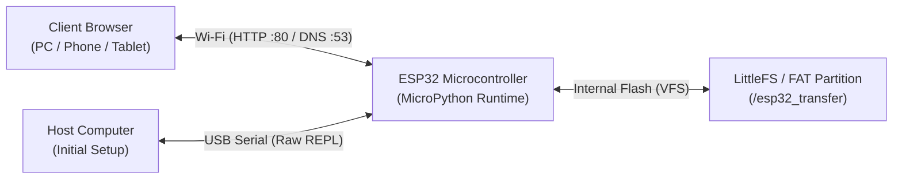
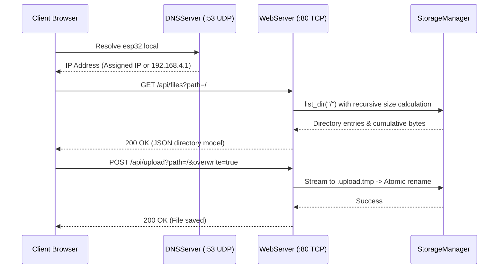

<div align="center">

# ESP32 File Transfer Tool

**A lightweight, browser-based file manager and transfer utility for MicroPython-powered ESP32 microcontrollers over local Wi-Fi.**

[](LICENSE)
[](https://micropython.org/)
[](https://www.espressif.com/en/products/socs/esp32)

[Report a Bug](https://github.com/sumitrawat2417/esp32-transfer/issues) · [Request a Feature](https://github.com/sumitrawat2417/esp32-transfer/issues)

</div>

---

## Overview

**ESP32 File Transfer Tool** is an embedded web utility that runs directly on an ESP32 microcontroller running MicroPython. It hosts a local single-page web application over Wi-Fi, allowing users to browse, upload, download, view, and organize files stored on the board's internal flash memory from any modern browser.

**The problem:** Managing auxiliary assets on MicroPython devices—such as configuration JSON files, UI graphics, text logs, web assets, and modular Python libraries—typically requires physical USB tethering and a desktop serial tool like Thonny. Updating files in field setups or enclosed IoT enclosures without disassembly is cumbersome.

**The approach:** The tool packages an HTTP web server, a non-blocking DNS server for captive portal support and mDNS (`http://esp32.local/`), a recursive filesystem engine, and a complete self-contained web interface into a single target directory (`esp32_transfer/`). When powered on, the ESP32 either connects to an existing local Wi-Fi network (Station mode) or creates its own standalone access point (AP mode), letting any computer or mobile phone manage the board's filesystem without installing software or tethering cables.

---

## Features

- **Self-contained MicroPython package:** All application runtime code, configurations, and static assets reside within `/esp32_transfer/`, keeping the root directory clean for user projects.
- **Embedded single-page web interface:** Responsive dark-themed UI built with vanilla HTML, CSS, and modern JavaScript, featuring zero external CDN dependencies to operate fully offline.
- **Dual Wi-Fi operational modes:**
  - *Station (STA) mode:* Connects as a client to an existing 2.4 GHz wireless network or mobile hotspot.
  - *Access Point (AP) mode:* Generates an independent wireless network (`ESP32-FileTransfer` at `192.168.4.1`) with captive portal redirection.
  - *Automatic failover:* Automatically falls back to Access Point mode if a configured router connection times out.
- **Interactive terminal Wi-Fi wizard:** Includes a serial REPL scanner (`esp32_transfer.setup_wifi()`) that detects nearby networks and configures credentials interactively.
- **Chunked streaming transfers:** Reads and writes network payloads in 1024-byte chunks, keeping memory consumption flat and preventing out-of-memory errors on RAM-constrained boards.
- **Atomic upload staging:** Streams inbound uploads to temporary `.upload.tmp` files and verifies payload integrity before atomically replacing target files.
- **Storage monitoring and safety checks:** Queries real-time flash capacity via `os.statvfs` and compares available space against incoming `Content-Length` headers before accepting file writes.
- **Recursive directory sizing and analytics:** Calculates cumulative directory weights using recursive `os.ilistdir` traversal and displays proportional capacity badges and gradient bars in the web interface.
- **Inline file viewer:** Inspects text and configuration files up to 4,000 lines directly in the browser with line numbering and clipboard copying.
- **Live client-side filtering:** Real-time search input dynamically filters directory listings by name without server round-trips.
- **Differential deployment tool:** Includes a host-side deployment script (`deploy.py`) that auto-detects the connected COM port, computes SHA-256 hashes of on-board files via raw REPL, and only writes modified files to preserve flash endurance.

---

## Tech Stack

| Area | Technology | Purpose |
| --- | --- | --- |
| Microcontroller Firmware | MicroPython (v1.19+) | Python runtime on the ESP32 |
| Backend & Server | MicroPython `socket`, `network`, `os` | Embedded HTTP/1.1 socket server, REST routing, and DNS captive portal |
| Frontend | Vanilla HTML5, CSS3, JavaScript (ES6+) | Single-page application, dark theme, interactive modals, responsive tables |
| Host Tooling | Python 3, PySerial | Differential sync deployment engine (`deploy.py`), raw REPL serial communicator |
| Packaging | PyInstaller, Windows Batch | One-click desktop launcher (`install.bat`) and standalone executable recipe |

---

## Hardware Overview

The firmware is designed for standard ESP32 development boards equipped with an onboard USB-to-UART bridge (Silicon Labs CP2102, WCH CH340, CH9102, or FTDI).



### Bill of Materials

| Qty | Component | Model / Part | Purpose | Notes |
| ---: | --- | --- | --- | --- |
| 1 | Development Board | ESP32-WROOM-32 / ESP32-WROVER | Target microcontroller | Any standard 30-pin or 38-pin board with 4 MB+ flash |
| 1 | USB Cable | Micro-USB or USB-C (data-capable) | Firmware installation and serial REPL | Must support USB data lines, not charge-only |
| 1 | Host Computer | Windows, macOS, or Linux | Initial setup and flashing | Python 3.8+ with `pyserial` installed |

### Power Specifications

- **Supply Voltage:** 5 V DC supplied via USB port (or regulated 3.3 V on the 3V3 rail).
- **Wi-Fi Radio Frequency:** 2.4 GHz b/g/n (ESP32 hardware does not support 5 GHz Wi-Fi).

---

## Architecture

The project decouples host deployment utilities from the on-board runtime package:

```text
esp32-transfer/
├── esp32_transfer/              # Target MicroPython package (flashed to ESP32)
│   ├── __init__.py              # Public package exports: start(), run(), setup_wifi()
│   ├── app.py                   # Thonny IDE launcher (Run F5)
│   ├── config.py                # ConfigManager: schema validation & fallback defaults
│   ├── config.json              # Device configuration file (Wi-Fi and server settings)
│   ├── wifi.py                  # WiFiManager: Station connection & AP fallback controller
│   ├── dns.py                   # DNSServer: UDP captive portal and mDNS resolver
│   ├── storage.py               # StorageManager: recursive sizing, atomic I/O, hash verification
│   ├── server.py                # WebServer: non-blocking HTTP socket server & REST routing
│   ├── setup_wifi.py            # Interactive terminal Wi-Fi scanning wizard
│   └── www/
│       └── index.html           # Production single-page application (zero external CDNs)
├── tools/
│   ├── deploy.py                # PC-side differential sync uploader (raw REPL)
│   └── build_installer.bat      # PyInstaller build script for standalone executable
├── install.bat                  # One-click Windows runner
├── LICENSE                      # MIT License
└── README.md                    # Project documentation
```

### HTTP Request Lifecycle



---

## Getting Started

### Prerequisites

1. **MicroPython Firmware:** Install standard MicroPython firmware (v1.19 or later) on your ESP32 board.
2. **Python Environment (Host PC):** Python 3.8+ with the `pyserial` package:
   ```bash
   pip install pyserial
   ```
3. **USB Serial Driver:** Ensure your computer recognizes the board's USB-to-UART bridge (CP210x or CH340 drivers).

---

### Installation (Flashing to ESP32)

> **Important:** Close Thonny, PuTTY, Arduino IDE, or any other software holding the COM port open before running the deployment script.

#### Option 1: One-Click Windows Installer
Connect the ESP32 via USB and double-click **`install.bat`** in the repository root.

#### Option 2: Command Line (Windows, macOS, Linux)
```bash
git clone https://github.com/sumitrawat2417/esp32-transfer.git
cd esp32-transfer
python tools/deploy.py
```

The uploader automatically:
1. Detects the active serial COM port.
2. Connects to the MicroPython raw REPL.
3. Purges legacy root files from previous versions.
4. Creates `/esp32_transfer/` and `/esp32_transfer/www/` directories.
5. Computes SHA-256 hashes of on-board files and uploads only modified files.
6. Preserves existing saved Wi-Fi credentials in `config.json`.
7. Soft-reboots the microcontroller.

---

## Usage

### 1. Launching the Server

#### Method A: Single Command in REPL
Open your preferred serial terminal (Thonny, PuTTY, mpremote) at 115200 baud and run:
```python
import esp32_transfer
esp32_transfer.start()
```

#### Method B: Thonny IDE F5 Runner
1. In Thonny, navigate to **File > Open > MicroPython device**.
2. Open `/esp32_transfer/app.py`.
3. Press **F5** (Run current script).

---

### 2. Connecting to the Web Interface

Upon startup, the serial console outputs the active network mode and connection address:

#### When in Access Point Mode (Default):
1. Connect your PC, phone, or tablet to the Wi-Fi network:
   - **SSID:** `ESP32-FileTransfer`
   - **Password:** *(Open by default, no password)*
2. Open your browser and navigate to:
   ```text
   http://192.168.4.1/
   ```
   *(or `http://esp32.local/` on supported devices)*

#### When in Station Mode:
Ensure your computer or mobile device is connected to the same local Wi-Fi router, then open:
```text
http://esp32.local/
```
*(or the explicit IP address printed in the terminal console, e.g. `http://192.168.1.150/`)*

---

### 3. Configuring Wi-Fi Credentials

#### Method A: Via the Web Interface
1. Click the **Wi-Fi** button in the top navigation bar.
2. Enter your 2.4 GHz Wi-Fi SSID and Password.
3. Click **Save & Reboot**. The ESP32 will store the credentials in `esp32_transfer/config.json` and restart.

#### Method B: Via the Terminal Wizard
In the MicroPython REPL, run:
```python
import esp32_transfer
esp32_transfer.setup_wifi()
```
The utility scans for nearby wireless networks, displays a numbered list ranked by signal strength, and prompts for your network index and password.

---

## Configuration

Settings are stored on the board in `/esp32_transfer/config.json`:

```json
{
  "wifi": {
    "hostname": "esp32",
    "sta_ssid": "",
    "sta_password": "",
    "ap_ssid": "ESP32-FileTransfer",
    "ap_password": "",
    "connect_timeout_s": 15
  },
  "server": {
    "port": 80,
    "chunk_size": 1024,
    "static_dir": "esp32_transfer/www"
  }
}
```

| Field | Type | Default | Description |
| --- | --- | --- | --- |
| `wifi.hostname` | String | `"esp32"` | Hostname registered via DHCP and mDNS (`http://esp32.local/`) |
| `wifi.sta_ssid` | String | `""` | Target 2.4 GHz Wi-Fi network name for Station mode |
| `wifi.sta_password` | String | `""` | Password for the target Wi-Fi network |
| `wifi.ap_ssid` | String | `"ESP32-FileTransfer"` | Broadcast SSID when operating in Access Point mode |
| `wifi.ap_password` | String | `""` | Access Point security key (leave empty for open access) |
| `wifi.connect_timeout_s` | Integer | `15` | Timeout in seconds before falling back from STA to AP mode |
| `server.port` | Integer | `80` | TCP port on which the HTTP server listens |
| `server.chunk_size` | Integer | `1024` | Buffer chunk size in bytes for network and flash streaming |
| `server.static_dir` | String | `"esp32_transfer/www"` | Flash directory containing static web application assets |

---

## REST API Reference

The embedded HTTP server exposes the following REST endpoints. Wildcard CORS (`Access-Control-Allow-Origin: *`) is enabled on all responses:

| Method | Endpoint | Parameters / Payload | Status | Description |
| --- | --- | --- | --- | --- |
| `GET` | `/` | None | 200 | Serves the single-page application (`index.html`) |
| `GET` | `/api/storage` | None | 200 | Flash storage metrics (`total_bytes`, `free_bytes`, `used_pct`, MBs) |
| `GET` | `/api/files` | Query: `path` (default: `/`) | 200 | Returns directory metadata and entries array (`{"path": "...", "entries": [...]}`) |
| `POST` | `/api/upload` | Query: `path` (destination file), `overwrite` | 201 | Streams payload to target path via atomic `.upload.tmp` staging |
| `GET` | `/api/download` | Query: `path` | 200 | Streams requested file with `Content-Disposition: attachment` |
| `DELETE` | `/api/files` | Query: `path` | 200 | Deletes a file or recursively removes a directory tree |
| `POST` | `/api/mkdir` | Query: `path` | 201 | Recursively creates parent and target directories on flash |
| `GET` | `/api/hash` | Query: `path` | 200 | Computes SHA-256 checksum (`{"path": "...", "sha256": "..."}`) |
| `GET` | `/api/wifi` | None | 200 | Returns mode (`AP`/`STA`), active IP, hostname, and SSID config |
| `POST` | `/api/wifi` | Body: `{"sta_ssid": "...", "sta_password": "..."}` | 200 | Writes credentials to `config.json` and initiates soft-reboot |

---

## Status and Known Limitations

**Status:** Stable release (v1.0.0). Packaged as a self-contained library directory.

- **2.4 GHz Wi-Fi Only:** The ESP32 hardware radio only supports 2.4 GHz networks. 5 GHz Wi-Fi networks will not be detected or supported.
- **MicroPython Heap Constraints:** While file transfers stream in 1 KB chunks, opening text files larger than 100 KB in the browser's inline viewer can stress the browser rendering thread. For large logs, use the **Download** feature.
- **Port Locking during Flash:** The deployment script communicates via the USB-to-UART bridge. If Thonny or a terminal emulator remains connected to the COM port, the script will be denied access.
- **mDNS Support Variations:** While `http://esp32.local/` functions on Windows 10/11, macOS, and iOS, some older Android versions require navigating directly to the board's numeric IP address (`http://192.168.4.1/` in AP mode).

---

## Challenges and Lessons

- **RAM Fragmentation in MicroPython:**  
  *Challenge:* Reading an entire 500 KB file into memory for HTTP transmission causes immediate `MemoryError` crashes on microcontrollers with ~100 KB free heap.  
  *Solution:* All download and upload routines use a streaming generator pattern bounded to 1024-byte chunk buffers, followed by explicit calls to `gc.collect()` after each transaction.
- **MicroPython Directory Sizing:**  
  *Challenge:* Unlike desktop OS filesystems, MicroPython's `os.stat()` on a directory returns 0 bytes rather than its aggregate weight.  
  *Solution:* Implemented recursive directory traversal in `StorageManager.get_dir_size()` using `os.ilistdir()`, allowing the frontend to present true cumulative folder storage metrics.
- **Root Filesystem Pollution:**  
  *Challenge:* Early iterations scattered utility scripts across the ESP32 root directory, making it difficult for users to distinguish system files from their personal project scripts.  
  *Solution:* Refactored all application logic into the self-contained `esp32_transfer/` package with a triple-fallback import architecture, keeping the root directory clean.

---

## Contributing

Contributions, bug reports, and feature proposals are welcome.

1. Fork the repository and create a feature branch (`git checkout -b feature/improvement`).
2. Verify all Python syntax locally:
   ```bash
   python -m py_compile esp32_transfer/__init__.py
   python -m py_compile esp32_transfer/server.py
   python -m py_compile tools/deploy.py
   ```
3. Commit your changes using descriptive commit messages.
4. Push to your branch and submit a Pull Request.

*(Note: Internal design notes and development documentation reside in the local `docs/` folder, which is excluded from the Git repository).*

---

## License

This project is licensed under the [MIT License](LICENSE).

---

<div align="center">

**Designed and developed by [Forbit](https://github.com/sumitrawat2417) (Sumit Rawat)**

[GitHub](https://github.com/sumitrawat2417)

</div>
