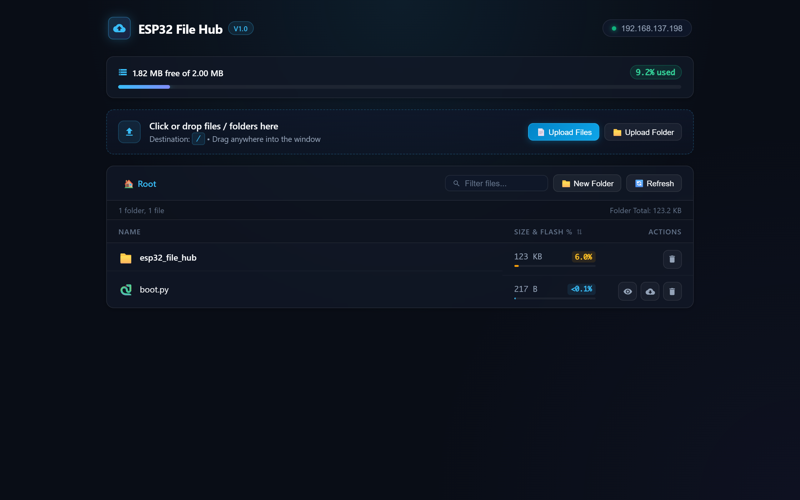
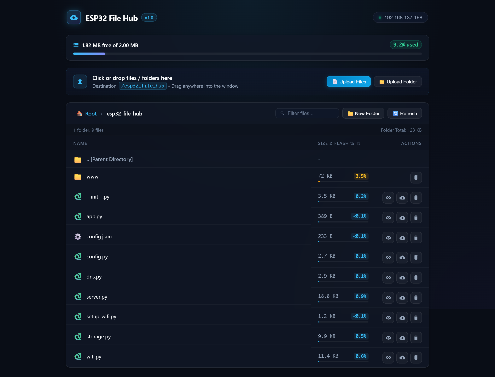
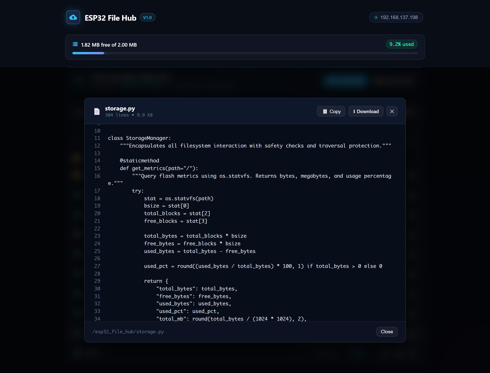
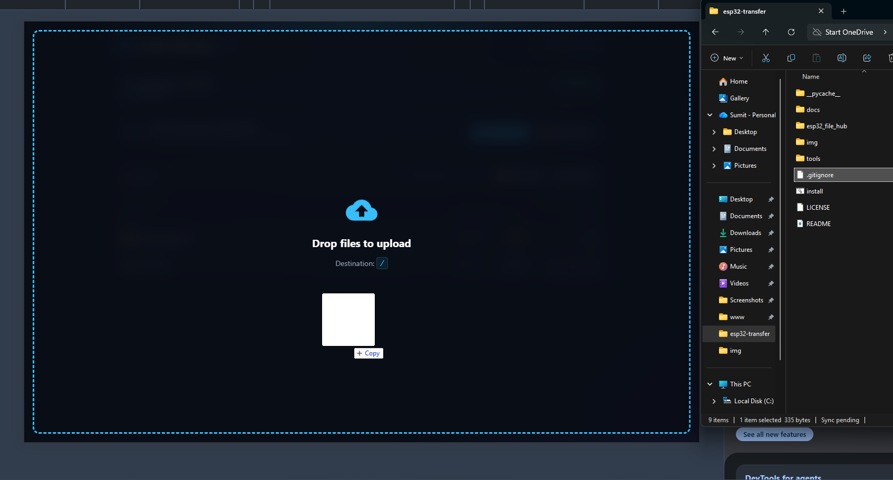
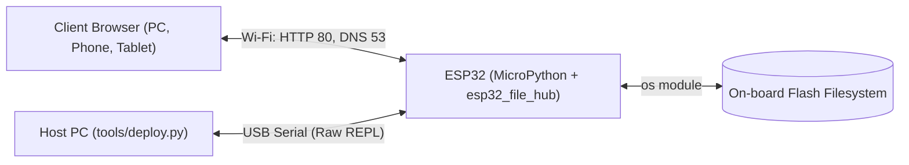
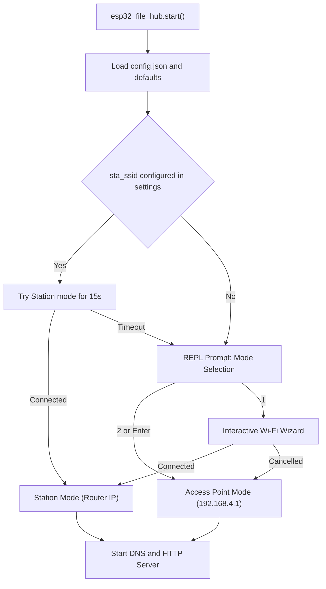
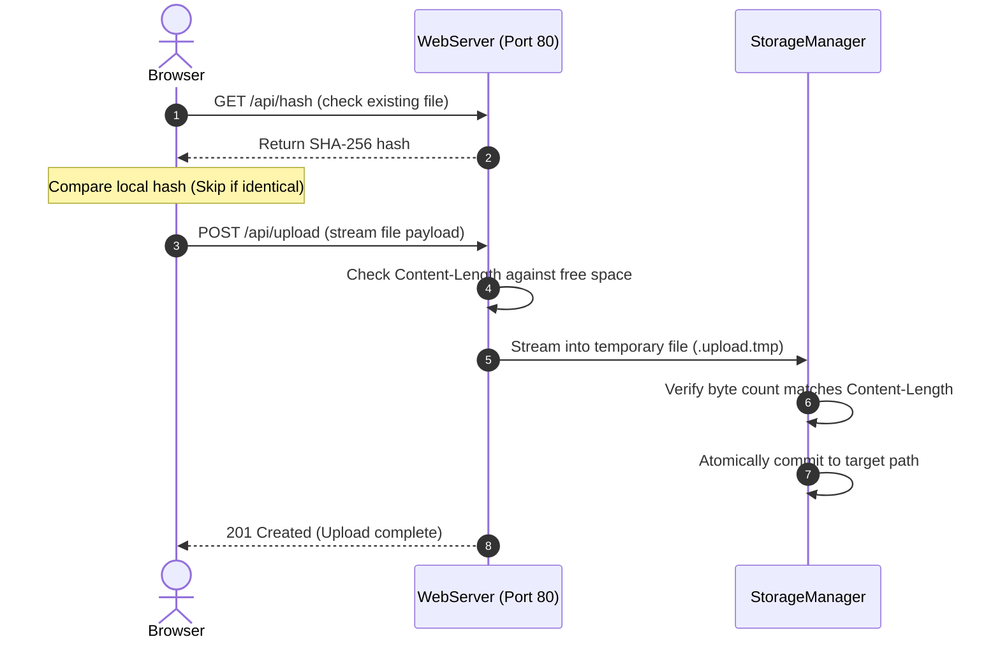
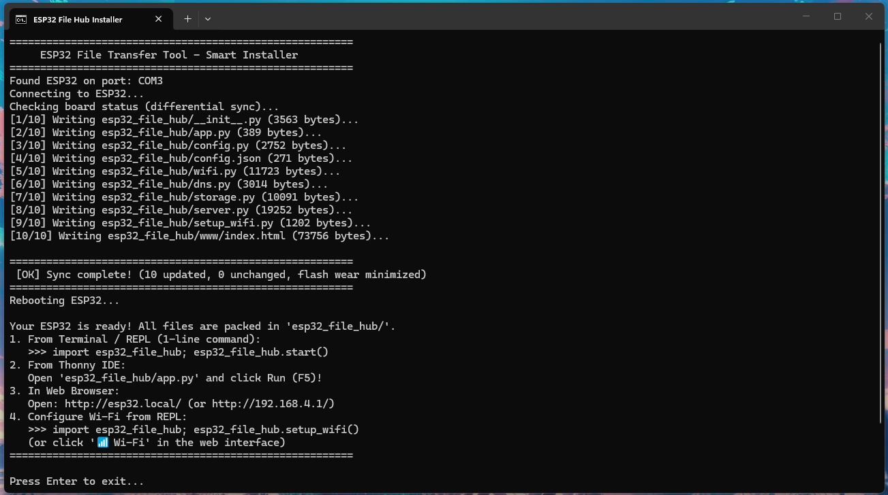
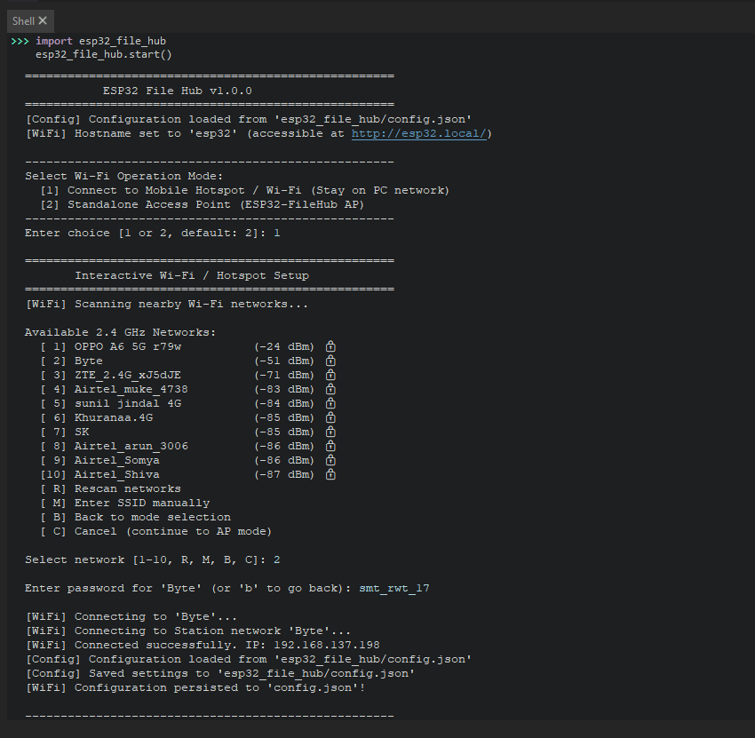
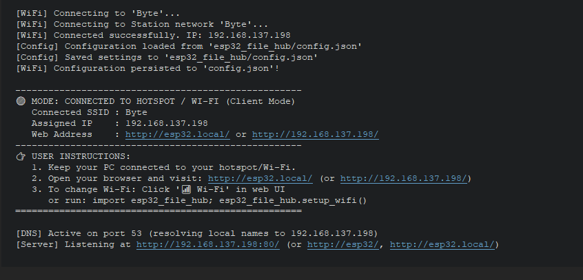

<div align="center">

# ESP32 File Hub

**A lightweight, standalone wireless file manager & modern Web UI that runs directly on an ESP32 with MicroPython. Browse, upload, download, view, and organize files over Wi-Fi without a USB cable.**

[](LICENSE)
[](https://micropython.org/)
[](https://www.espressif.com/en/products/socs/esp32)

[Report a Bug](https://github.com/sumitrawat2417/esp32-file-hub/issues) · [Request a Feature](https://github.com/sumitrawat2417/esp32-file-hub/issues)

<br/><br/>



</div>

---

## Overview

**ESP32 File Hub** is a MicroPython package that turns your ESP32 into a self-hosted micro-NAS and web-based file management hub: manage scripts, configuration files, web assets, and logs from any phone, tablet, or laptop.

**The problem:** Moving files on and off a MicroPython board normally requires a USB cable and a desktop IDE like Thonny. That is inconvenient when the board is mounted in an enclosure, placed in a remote setup, or deployed away from your workstation.

**The approach:** The board serves its own dark-glassmorphism single-page web interface over HTTP. It either joins an existing 2.4 GHz Wi-Fi network (Station mode) or hosts its own hotspot (Access Point mode), letting any modern browser manage the flash filesystem. All runtime code lives in a single directory, `/esp32_file_hub`, keeping the board's root clean for your own files. The interface has zero external CDN or cloud dependencies, working 100% offline. USB is needed only once, to install the package.

## Features

**File management**

- **Browse and navigate:** Breadcrumb navigation with folders listed first, then files alphabetically.
- **Upload files and folders:** Use the file picker, the folder picker, or drag and drop. Nested folder structures are recreated on the board.
- **Duplicate-aware uploads:** When a file already exists, the browser compares sizes and SHA-256 hashes and skips identical files. For genuine conflicts you choose Replace or Skip, and batch uploads add Skip All and Replace All.
- **Download, delete, and create folders:** Deleting asks for confirmation and removes directory trees recursively.
- **Inline file viewer:** Opens recognized text and code files (for example `.py`, `.json`, `.txt`, `.log`, `.html`) with line numbers and a copy button, showing up to 4,000 lines.
- **Live filter:** Filters the current directory by name in the browser, with no requests to the board.
- **Size and share display:** Each entry shows its size and its share of the current directory as a percentage and a bar. Folder sizes are calculated recursively.
- **Storage meter:** Shows free, total, and used flash space.

**Networking**

- **Two Wi-Fi modes:** Station mode joins your router or phone hotspot. Access Point mode creates the `ESP32-FileHub` network.
- **Wi-Fi setup without USB:** Change the network from the web interface, or run the interactive terminal wizard, which scans for networks and lists them by signal strength.
- **Name resolution:** Sets the board hostname (default `esp32`) and runs a small DNS responder on UDP port 53 that answers every query with the board's IP address.
- **Quiet connectivity probes:** Answers the Windows and Android captive-portal checks (`/connecttest.txt`, `/generate_204`) and `/favicon.ico` without log noise.

**Memory and file safety**

- **Streaming I/O:** Uploads, downloads, and the web page itself are read and written in 1 KB chunks (configurable), with `gc.collect()` after each request.
- **Space check before writing:** An upload is rejected if its `Content-Length` exceeds free flash space.
- **Temporary-file staging:** Uploads are written to a `.upload.tmp` file and only committed if the received byte count matches `Content-Length`.
- **Path normalization:** Paths are normalized so `..` segments cannot climb above the filesystem root, and the root itself cannot be deleted.

**Host tooling**

- **Differential installer:** `tools/deploy.py` finds the board's serial port, compares SHA-256 hashes, and uploads only the files that changed, which limits flash writes.
- **One-click launcher:** `install.bat` runs the installer on Windows. `tools/build_installer.bat` builds a standalone executable with PyInstaller.

## Interface Preview

| Directory Navigation & Breadcrumbs | In-Browser Text & Code Viewer |
| :---: | :---: |
|  |  |
| *Subfolder browsing with instant client-side caching* | *Inline viewer with line numbers, copy & download* |

<div align="center">
  <br/>
  
  <p><em>Smart conflict resolution: real-time SHA-256 duplicate detection with Replace & Skip controls</em></p>
</div>

## Tech Stack

| Area | Technology | Purpose |
| --- | --- | --- |
| Firmware | MicroPython (v1.19+) | Python runtime on the ESP32 |
| On-board server | MicroPython `socket`, `network`, `os` | HTTP/1.1 socket server, REST routing, DNS responder, filesystem access |
| Web interface | Vanilla HTML5, CSS3, JavaScript (ES6+) in one `index.html` | Single-page file manager with no external dependencies |
| Host tooling | Python 3, PySerial | Raw REPL communication and differential sync (`tools/deploy.py`) |
| Packaging | Windows batch, PyInstaller | One-click launcher and standalone installer build |

## Hardware Overview

The project targets a standard ESP32 development board with an onboard USB-to-UART bridge (CP210x, CH340, CH9102, or FTDI). It needs no external components and does not configure any GPIO pins. The board connects over 2.4 GHz Wi-Fi at runtime and over USB serial for installation.



### Bill of Materials

| Qty | Component | Model / part number | Purpose | Notes |
| ---: | --- | --- | --- | --- |
| 1 | Development board | ESP32-WROOM-32 or ESP32-WROVER | Target microcontroller | Any standard 30-pin or 38-pin board with 4 MB or more of flash |
| 1 | USB cable | Micro-USB or USB-C | Installation and serial REPL | Must carry data, not charge only |
| 1 | Host computer | Windows, macOS, or Linux | Installation | Python 3.8+ with `pyserial` |

### Power

- **Supply:** 5 V DC over USB, or regulated 3.3 V on the 3V3 pin.
- **Wi-Fi band:** 2.4 GHz b/g/n only. The ESP32 radio does not support 5 GHz.

## Architecture

On boot, `start()` loads the configuration, brings up Wi-Fi, and then enters a single-threaded loop that polls the DNS socket and accepts HTTP connections one at a time.



An upload from the browser follows this path:



The HTTP server, DNS responder, and storage layer share one thread. DNS is polled between `accept()` calls, which use a 0.2 s timeout. That avoids the memory cost of threads, but it also means requests are handled one at a time.

## Getting Started

### Prerequisites

- An ESP32 development board running MicroPython v1.19 or later ([firmware downloads](https://micropython.org/download/ESP32_GENERIC/))
- A USB data cable and the driver for your board's USB-to-UART bridge (CP210x or CH340)
- Python 3.8 or later on the host PC, with PySerial:

  ```bash
  pip install pyserial
  ```
- Git

### Install onto the board

Close Thonny, PuTTY, the Arduino IDE, and any other program that holds the serial port open. The installer cannot connect while the port is in use.

> [!WARNING]
> Before copying files, the installer deletes these items from the board's root if they exist: `main.py`, `config.json`, `file_manager.py`, `web_server.py`, `wifi_manager.py`, `setup_wifi.py`, `esp32_transfer.py`, and the folders `lib/`, `app/`, and `www/`. They are leftovers from earlier layouts of this project. Back up anything of your own that lives there before you run it.

**Option 1: One-click installer (Windows)**

Connect the board over USB and double-click `install.bat` in the repository root.

<div align="center">
  <br/>
  
  <p><em>Automatic port detection, differential SHA-256 sync, and board reboot</em></p>
</div>

**Option 2: Command line (Windows, macOS, Linux)**

```bash
git clone https://github.com/sumitrawat2417/esp32-file-hub.git
cd esp32-file-hub
python tools/deploy.py
```

The installer:

1. Detects the serial port by matching the port description against `cp210`, `ch340`, `ch9102`, `ftdi`, `usb to uart`, and `esp32`. If none match, it uses the first port that is not `COM1`.
2. Opens the MicroPython raw REPL.
3. Removes legacy files and directories (`esp32_transfer`, `lib/`, `app/`, `www/`).
4. Creates `/esp32_file_hub` and `/esp32_file_hub/www`.
5. Reads SHA-256 hashes of the package files already on the board and uploads only the ones that differ.
6. Keeps an existing `esp32_file_hub/config.json` so saved Wi-Fi credentials survive re-installs.
7. Leaves the raw REPL and closes the port.

### Start the server

The server does not start by itself after installation. Choose one way to start it.

**From the REPL** (115200 baud, using Thonny, PuTTY, or `mpremote`):

```python
import esp32_file_hub
esp32_file_hub.start()
```

**From Thonny:** open `/esp32_file_hub/app.py` from the MicroPython device (File, Open, MicroPython device) and press F5.

**On every boot:** create a `main.py` on the board containing:

```python
import esp32_file_hub
esp32_file_hub.start()
```

### Verify it works

If no network is saved yet, the REPL first asks how the board should connect. Press Enter to accept the default, Access Point mode:

| Wi-Fi Mode Selection Prompt | Connection Banner & Web Address |
| :---: | :---: |
|  |  |
| *Select between Station mode or Standalone AP* | *REPL displays assigned IP, mDNS address, and mode* |

```text
Select Wi-Fi Operation Mode:
  [1] Connect to Mobile Hotspot / Wi-Fi (Stay on PC network)
  [2] Standalone Access Point (ESP32-FileHub AP)
Enter choice [1 or 2, default: 2]:
```

The REPL then prints a banner like this one (abridged):

```text
====================================================
           ESP32 File Hub v1.0.0
====================================================
...
📡 MODE: STANDALONE ACCESS POINT (Host Mode)
   Wi-Fi Name (SSID) : ESP32-FileHub
   Board IP          : 192.168.4.1
   Web Address       : http://192.168.4.1/ or http://esp32.local/
```

Join the `ESP32-FileHub` network (open by default) and browse to `http://192.168.4.1/`. You should see the storage meter and the root directory listing. In Station mode, the banner shows the assigned IP and `http://esp32.local/` instead.

### Troubleshooting

| Symptom | Likely cause and fix |
| --- | --- |
| Installer reports the port is busy | Another program holds the serial port. Close Thonny and any serial monitor, then retry. |
| Installer reports no ESP32 detected | Use a data-capable USB cable and install the CP210x or CH340 driver. |
| The page does not load in Access Point mode | Phones often drop a Wi-Fi network that has no internet. Keep the connection when prompted and turn off mobile data while you work. |
| `esp32.local` does not resolve | Use the board's IP address from the REPL banner. Some clients do not resolve `.local` names. |
| The board never joins your Wi-Fi | The ESP32 supports 2.4 GHz only. Check the SSID, the password, and that the band is 2.4 GHz. |
| The page shows an old version after an update | Hard refresh with Ctrl+Shift+R (Cmd+Shift+R on macOS). |

### Configuration

Settings live in `/esp32_file_hub/config.json` on the board. Missing keys fall back to these defaults:

```json
{
  "wifi": {
    "hostname": "esp32",
    "sta_ssid": "",
    "sta_password": "",
    "ap_ssid": "ESP32-FileHub",
    "ap_password": "",
    "connect_timeout_s": 15
  },
  "server": {
    "port": 80,
    "chunk_size": 1024,
    "static_dir": "esp32_file_hub/www"
  }
}
```

| Key | Type | Default | Description |
| --- | --- | --- | --- |
| `wifi.hostname` | string | `"esp32"` | Board hostname, set with `network.hostname()` (reachable as `http://esp32.local/` where supported) |
| `wifi.sta_ssid` | string | `""` | 2.4 GHz network to join in Station mode |
| `wifi.sta_password` | string | `""` | Password for that network, stored as plain text |
| `wifi.ap_ssid` | string | `"ESP32-FileHub"` | Network name broadcast in Access Point mode |
| `wifi.ap_password` | string | `""` | Access Point password. Used (WPA2-PSK) only when it has at least 8 characters; otherwise the network is open |
| `wifi.connect_timeout_s` | integer | `15` | Seconds to wait for Station mode before giving up |
| `server.port` | integer | `80` | TCP port for the HTTP server |
| `server.chunk_size` | integer | `1024` | Buffer size in bytes for network and flash streaming |
| `server.static_dir` | string | `"esp32_file_hub/www"` | Directory that contains `index.html` |

## Usage

### Manage files in the browser

1. Open the board's address (`http://192.168.4.1/` in Access Point mode, or `http://esp32.local/` or the printed IP in Station mode).
2. Click a folder to enter it, or use the breadcrumb to go back up.
3. Upload by dropping files or folders on the drop zone, or use Upload Files and Upload Folder. The destination is the directory you are currently viewing.
4. If a file already exists, review the comparison and choose Replace or Skip.
5. Use the row actions to view, download, or delete an entry. Use New Folder to create a directory and the filter box to narrow the list.

### Change the Wi-Fi network

**From the web interface:** Click Wi-Fi, enter the SSID and password, and click Save & Connect. The board writes the credentials to `config.json` and resets. Reset to AP Host clears the saved network and resets the board.

**From the terminal:**

```python
import esp32_file_hub
esp32_file_hub.setup_wifi()
```

The wizard scans for networks, lists up to ten by signal strength, lets you rescan or type an SSID manually, and saves the credentials once the board connects.

Both web actions reset the board. The server only comes back on its own if you set up the `main.py` start-on-boot file described above. Otherwise, start it again from the REPL.

### REST API

The web interface uses this HTTP API, and you can call it directly. Errors return `{"error": "...", "status": <code>}`.

| Method | Endpoint | Parameters | Success response | Other statuses |
| --- | --- | --- | --- | --- |
| `GET` | `/` | none | The web interface (`index.html`) | 500 if the file is missing |
| `GET` | `/api/storage` | none | `total_bytes`, `free_bytes`, `used_bytes`, `used_pct`, `total_mb`, `free_mb`, `used_mb` | none |
| `GET` | `/api/files` | `path` (default `/`) | `{"path": "...", "entries": [{"name", "is_dir", "size"}]}`, folders first | 404 if the directory does not exist |
| `POST` | `/api/mkdir` | `path` | `201` with `{"success": true, "path": "..."}`. Parent folders are created | 400 without `path` |
| `GET` | `/api/download` | `path` | File stream with `Content-Disposition: attachment` | 404 if missing or a directory |
| `GET` | `/api/hash` | `path` | `{"path": "...", "sha256": "..."}` | 404 if missing or a directory |
| `POST` | `/api/upload` | `path` (full destination file path), `overwrite=true\|false` | `201` with `{"success": true, "path": "...", "size": N}`. Body is the raw file bytes | 400 without `path` or `Content-Length`, 409 if the file exists and `overwrite` is not `true`, 413 if there is not enough space, 500 on a write error |
| `DELETE` | `/api/files` | `path` | `{"success": true, "path": "..."}`. Directories are removed recursively | 404 if missing or if `path` is `/` |
| `GET` | `/api/wifi` | none | `mode`, `ip`, `hostname`, `connected_ssid`, `saved_sta_ssid`, `ap_ssid` | none |
| `POST` | `/api/wifi` | JSON body: `sta_ssid`, `sta_password`, optional `hostname` | `{"success": true, "message": "..."}`, then the board resets | 400 for invalid JSON |

Examples:

```bash
# List the root directory
curl "http://esp32.local/api/files?path=/"

# Upload a file (creates /data if needed)
curl -X POST --data-binary @notes.txt "http://esp32.local/api/upload?path=/data/notes.txt&overwrite=true"

# Download it again
curl -o notes.txt "http://esp32.local/api/download?path=/data/notes.txt"

# Delete it
curl -X DELETE "http://esp32.local/api/files?path=/data/notes.txt"
```

Notes for API clients: every response closes the connection, uploads need a `Content-Length` header (chunked request bodies are not supported), and request headers must fit in 4,096 bytes. Responses include `Access-Control-Allow-Origin: *`.

## Project Structure

```text
esp32-file-hub/
├── esp32_file_hub/            # Package copied to the ESP32
│   ├── __init__.py            # Public API: start(), run(), setup_wifi(), main
│   ├── app.py                 # Thonny F5 launcher
│   ├── config.py              # ConfigManager: defaults and merging
│   ├── config.json            # Default Wi-Fi and server settings
│   ├── wifi.py                # WiFiManager: Station, Access Point, scan wizard
│   ├── dns.py                 # DNSServer: UDP responder on port 53
│   ├── storage.py             # StorageManager: sizes, listing, hashing, staged writes
│   ├── server.py              # WebServer: HTTP loop and REST routes
│   ├── setup_wifi.py          # Terminal Wi-Fi wizard entry point
│   └── www/
│       └── index.html         # Single-page modern web interface
├── tools/
│   ├── deploy.py              # Host-side differential installer (PySerial, raw REPL)
│   └── build_installer.bat    # PyInstaller recipe for a standalone installer
├── install.bat                # One-click Windows launcher for deploy.py
├── LICENSE                    # MIT License
└── README.md
```

## Status and Known Limitations

**Status:** Version 1.0.0 (Latest).

- **Tested on:** A standard ESP32 development board with a CP210x/CH340-class USB-UART bridge, on Windows. The exact board revision and MicroPython build were not recorded. Other boards, macOS, and Linux are not verified.
- **No authentication:** Anyone who can reach the board can list, read, overwrite, and delete every file on it. That includes `esp32_file_hub/config.json`, which holds the saved Wi-Fi password in plain text. The Access Point is open unless you set `wifi.ap_password`, and the API sends `Access-Control-Allow-Origin: *`. Use it on networks you trust.
- **Prompt on first run and after a failed connection:** `start()` asks you to pick a Wi-Fi mode in the REPL when no network is saved or the saved one cannot be joined. It waits for your answer, so an unattended start cannot fall back to Access Point mode by itself.
- **No automatic restart:** The installer removes `main.py` from the board. After a reset, including the reset triggered by saving Wi-Fi settings, the server runs again only if you add the start-on-boot `main.py`.
- **Installer cleanup:** The installer deletes the legacy root files and folders listed under Getting Started.
- **Uploads are not a single atomic replace:** The file is staged and verified by byte count, but the commit removes the old file before renaming the staged one. A power loss in that moment could leave neither.
- **One request at a time:** The server is single-threaded, so a large transfer delays other requests. Uploads need a `Content-Length` header and use a 20-second socket timeout.
- **Viewer limits:** The viewer loads the whole file into the browser and shows the first 4,000 lines. Download large files instead.
- **2.4 GHz only:** 5 GHz networks cannot be seen or joined.
- **Name resolution varies:** `esp32.local` depends on the firmware build and the client operating system. The built-in DNS responder is only used by clients that take the board as their DNS server, typically in Access Point mode. The IP address always works.
- **No automated tests:** Changes are checked with `py_compile` and manual runs on a board.

## Challenges and Lessons

- **Challenge:** MicroPython boards have roughly 100 KB of free heap, so reading a large file into memory for an HTTP response fails.
  **What I did:** Downloads, uploads, and the web page itself are streamed in 1 KB chunks, and `gc.collect()` runs after every request. The trade-off is more small reads and writes, and one connection at a time.
- **Challenge:** `os.stat()` reports a size of 0 for directories on MicroPython, so folders showed no size.
  **What I did:** `StorageManager.get_dir_size()` walks each folder with `os.ilistdir()` and adds up file sizes. The cost is that listing a directory walks every subfolder, so very deep trees list more slowly.
- **Challenge:** Early versions scattered loose scripts across the board's root, mixing them with users' own files.
  **What I did:** Moved everything into the `esp32_file_hub/` package and gave every module a three-step import fallback (relative, package, bare) so it runs as a package, from Thonny, or as a flat script. The cost is repeated `try`/`except` blocks in each module.
- **Challenge:** Reading each request with a single `recv(1024)` truncated headers, which produced malformed requests.
  **What I did:** The server now reads 512-byte pieces until it finds the end of the headers, up to 4,096 bytes. Requests with larger headers are not supported.
- **Challenge:** Re-flashing every file on each deploy wears flash and is slow over serial.
  **What I did:** The installer compares SHA-256 hashes and writes only changed files, and it never overwrites a `config.json` that is already on the board.

## Contributing

Bug reports, feature ideas, and pull requests are welcome. Please open an [issue](https://github.com/sumitrawat2417/esp32-file-hub/issues) first for larger changes.

1. Fork the repository and create a branch such as `feature/my-change`.
2. Keep the on-board code dependency-free and small: nothing outside `esp32_file_hub/` is needed at runtime, the web interface must work offline with no CDN, and file I/O should stay chunked with `gc.collect()` at sensible points.
3. Check syntax before flashing:

   ```bash
   python -m py_compile esp32_file_hub/__init__.py esp32_file_hub/app.py esp32_file_hub/config.py esp32_file_hub/dns.py esp32_file_hub/server.py esp32_file_hub/setup_wifi.py esp32_file_hub/storage.py tools/deploy.py
   ```

   `wifi.py` imports the MicroPython-only `network` module, so check it by reading it carefully.
4. Test on a board in both modes: Access Point (upload, view, download, delete) and Station (`http://esp32.local/` loads). Also try nested folders and an upload with little free space.
5. Write commit messages with a type prefix such as `feat:`, `fix:`, `refactor:`, `docs:`, or `test:`, then open a pull request.

## License

This project is released under the [MIT License](LICENSE).

## Acknowledgements

- [MicroPython](https://micropython.org/): the runtime this project is built for.
- [PySerial](https://github.com/pyserial/pyserial): serial communication in the host installer.
- [PyInstaller](https://pyinstaller.org/): builds the standalone installer executable.

---

<div align="center">

**Designed and developed by [Forbit](https://github.com/sumitrawat2417) (Sumit Rawat)**

[GitHub](https://github.com/sumitrawat2417)

</div>
